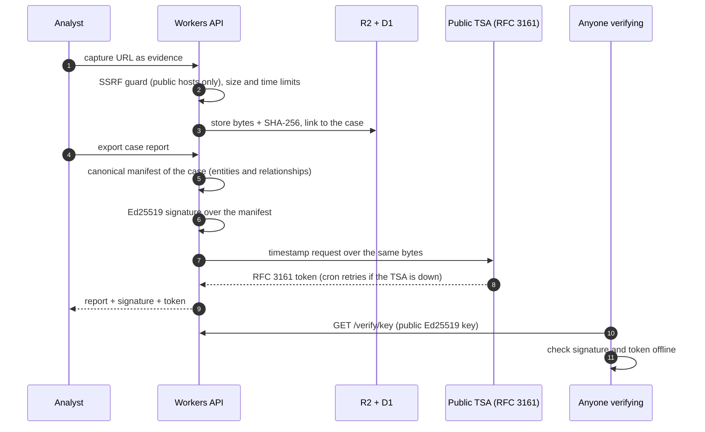
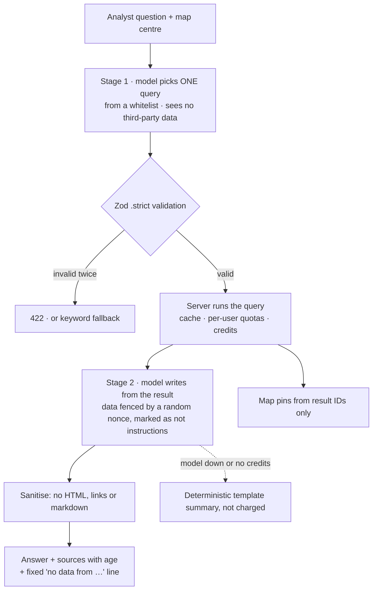
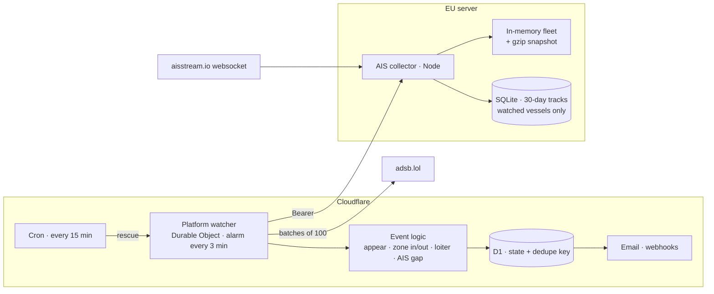
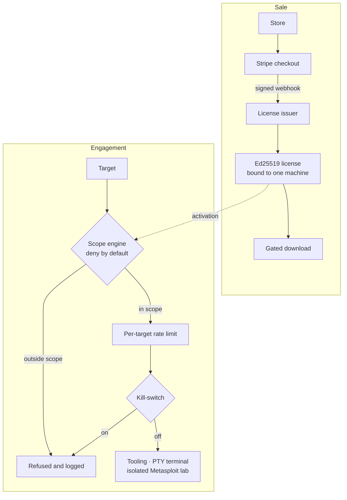

# Architecture notes

How the critical parts of my two production products work. The code is private (they are commercial), so these notes show the design decisions and the controls, not the implementation. Each diagram is followed by the reasons behind it.

- [TRACEZ · tamper-evident evidence](#tracez--tamper-evident-evidence)
- [TRACEZ · asking the map without trusting the model](#tracez--asking-the-map-without-trusting-the-model)
- [TRACEZ · aircraft and ship watches](#tracez--aircraft-and-ship-watches)
- [GRIMZ · licensing and scope control](#grimz--licensing-and-scope-control)

---

## TRACEZ · tamper-evident evidence

- **The manifest is canonical JSON**, so the same case always produces the same bytes and the same hash. The signature and the timestamp cover exactly those bytes.
- **Ed25519, not an HMAC.** A shared secret would mean "trust us". A public key means anyone can check a report without an account and without calling the server.
- **The timestamp comes from an outside authority**, so the date of a report does not depend on my clock. If the TSA is down when the report is exported, a cron job retries for 24 hours instead of blocking the analyst.
- **Captured pages are downloaded as opaque files** (`application/octet-stream`, `Content-Security-Policy: sandbox`, `nosniff`): hostile evidence can never run in the app's origin.

## TRACEZ · asking the map without trusting the model

- **Prompt injection has nowhere to enter stage 1**: vessel names, callsigns and page titles are third-party text, and the model that chooses the query never sees them.
- **Stage 2 has no tools.** Even if injected text convinces it of something, it can only write words, and those are escaped.
- **Pins and links never come from the model's text**, only from the IDs in the query result.
- **"No data" is enforced by the server.** A small model tends to say "there are no ships" when the AIS source is simply empty, so the server appends the line itself.

## TRACEZ · aircraft and ship watches

- **Zone entry and exit use segment–circle intersection** between two samples, with 15 % hysteresis and two observations, so an aircraft at 800 km/h cannot cross a zone unseen and a ship anchored on the edge does not flap.
- **"No AIS reception despite apparent coverage", never "AIS switched off".** The alert needs nearby vessels being received, and the number of silent windows it requires comes from the measured local reception rate (false-alarm target 1 %).
- **The AIS collector moved off Cloudflare.** Durable Objects on the free plan allow 100k row writes per day per account; one row per vessel per round used it up in hours and stopped every other object. A small service on an EU server keeps the websocket open all the time, persists one snapshot instead of 6,000 rows, and keeps history only for vessels someone watches.
- **Privacy by design:** class A vessels only, no sailing or pleasure craft, no vessels under 20 m, and every watch needs a stated purpose. Aircraft in privacy programmes (LADD/PIA) are refused.

## GRIMZ · licensing and scope control

- **Deny by default.** A target is refused unless the engagement explicitly allows it: the safe state is the default, not a warning the operator can click through.
- **Licenses are signed, not looked up.** The client checks an Ed25519 signature bound to its machine, so a copied license file does not run elsewhere, and the issuer only signs after a Stripe webhook whose signature checks out.
- **A kill-switch and per-target rate limits** sit between the scope decision and the tooling, so stopping an engagement does not depend on the operator closing the right window.
