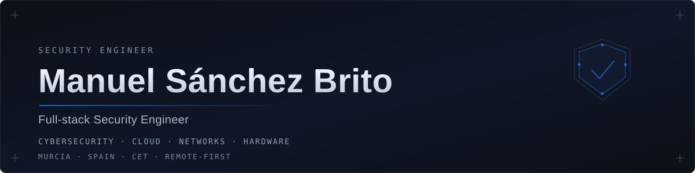

<!-- Banner: assets/banner.svg — single theme-invariant SVG committed under assets/. -->

  

**Full-stack Security Engineer** · Founder [@no-do.dev](https://no-do.dev) · Murcia, Spain (CET) · Remote-first

  
  
  
  

## About

I build security products end to end, from the hardware and networks up to the cloud that runs them.

Two are in production: **GRIMZ**, a self-hosted penetration-testing platform with live billing and a deny-by-default scope engine, and **TRACEZ**, an OSINT SaaS on the Cloudflare edge with tamper-evident, Ed25519-signed evidence. I also architected **DEEPWIRE**, a recon platform with private egress (retired in October 2026).

An electronics technician by training, self-taught in security, with six years mentored inside real network infrastructure. I care about **zero-trust defaults, verifiable evidence, and fixing the root cause with the smallest possible change.**

## What I build

| | |
|---|---|
| **GRIMZ** Pentesting platform · founder & lead engineer | Self-hosted product shipped end to end: license issuer, store, gated downloads, live Stripe billing. Deny-by-default scope engine with kill-switch, per-target rate limits, isolated Metasploit lab. Python · Flask · Stripe |
| **TRACEZ** OSINT intelligence SaaS · founder & lead engineer | Graph intelligence on the Cloudflare edge: Google SSO, 2FA, entity merge, Stripe billing. Ed25519-signed evidence with public verification, AI-assisted entity expansion with a human in the loop. Mobile Lighthouse 99, CLS 0 in production. TypeScript · Workers · D1 · R2 |
| **DEEPWIRE** Recon platform · architect · retired 2026 | Security-audited recon engine (scope bypass, CSRF, session revocation, rate limits). Scans left through a Tailscale exit node, so home infrastructure was never exposed. Cloudflare Worker · Tailscale · AWS |
| **Security operations & DFIR** Operator | Full incident response on a real infostealer: malware analysis, C2 attribution, credential rotation. Runs a Docker monitoring stack (Prometheus, Grafana, Uptime Kuma) with DNS filtering and a T-Pot honeypot. Ghidra · Tshark · T-Pot · Docker |

## Open source

- **[lazyios](https://github.com/Manuel-1312/lazyios)** — Terminal app for iPhones over USB, no jailbreak: syslog, per-app processes and network, packet capture with per-app connections, privacy score, tracker detection, anomaly rules, and offline session diffs and reports. On [PyPI](https://pypi.org/project/lazyios/) with Windows, macOS and Linux binaries, SHA-256 sums and build attestation. `Python` · `Textual`
- **[minimeters-bridge](https://github.com/Manuel-1312/minimeters-bridge)** — Real-time audio metering (LUFS R128, FFT, true peak, correlation) streamed over WebSocket from WASAPI loopback. `TypeScript` · `Python`
- **[realmeters-spotify](https://github.com/Manuel-1312/realmeters-spotify)** — Mastering-style audio visualizer for Spotify, a Spicetify custom app on the Marketplace. `TypeScript`
- **[personal-dictionary-of-ethical-hacking](https://github.com/Manuel-1312/personal-dictionary-of-ethical-hacking)** — A working reference of ethical-hacking concepts and tooling, with a script launcher and CI. `Python`

## Skills

| | |
|---|---|
| **Offensive & DFIR** | Ghidra · Metasploit · Nmap · Masscan · Tshark · T-Pot · malware analysis · incident response · honeypots · OSINT attribution · network traffic analysis · beaconing detection |
| **Cloud & edge** | Cloudflare (Workers, Pages, D1, R2, KV, WAF) · Docker · Stripe · AWS Lightsail · Tailscale · DNS · segmentation · controlled egress |
| **Languages & crypto** | Python (Flask) · TypeScript (Zod) · Go · C#/.NET (Blazor, EF Core) · Rust (PyO3) · AES-GCM · HKDF · Ed25519 |
| **Monitoring** | Prometheus · Grafana · Blackbox · Uptime Kuma · DNS filtering |
| **Hardware & firmware** | KiCad · Flux.ai (multilayer RF PCB) · reverse engineering · chip programming · board-level repair · ESP32 / ESP-IDF · MT7612U |

## Background

- **National Medical Library of Cuba · Infrastructure** — Havana, 2018–2024. Six years learning network infrastructure under the library's systems administrator: firewalls, web services and network administration across Infomed, Cuba's national health network.
- **Electronics & hardware workshop** — Havana, 2016–2018. Hands-on apprenticeship beside senior technicians: board-level repair, chip programming and hardware reverse engineering, the origin of my firmware work.

**Education** — IT Professional Training, Universidad de las Ciencias Informáticas (UCI), Havana (2021–2023) · Técnico Medio en Electrónica, Havana (2016–2019)

**Languages** — Spanish (native) · French (upper-intermediate) · English (C1)

## Contact

**Open to remote or hybrid roles** in Detection & Response, Cloud Security, Security Engineering and DevSecOps.

[LinkedIn](https://www.linkedin.com/in/manuel-sanchez-brito/) · [Email](mailto:nodo.automatizacion@gmail.com) · [no-do.dev](https://no-do.dev) · [CV (PDF)](Manuel-Sanchez-CV.pdf)
