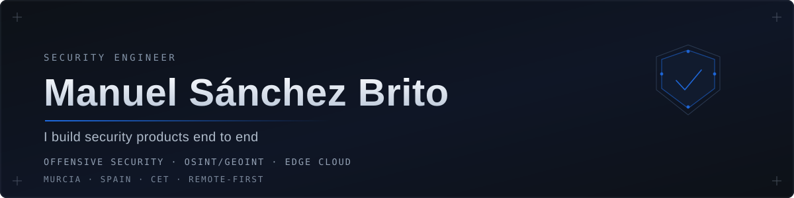
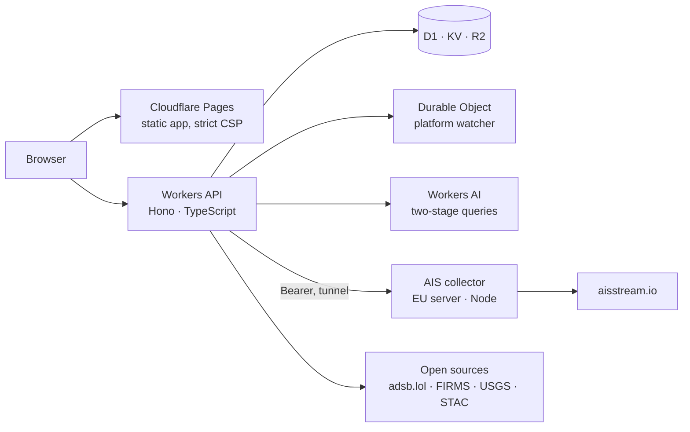

<!-- Banner: assets/banner.svg — single theme-invariant SVG committed under assets/. -->

  

**Security Engineer** · offensive-security and OSINT/GEOINT products · Founder [@no-do.dev](https://no-do.dev) · Murcia, Spain (CET) · Remote-first

  
  
  
  

## About

I build offensive-security and OSINT/GEOINT products end to end: the product, the edge cloud that runs it, and the evidence that it does what it says. Malware analysis, DFIR, networks and hardware are the background I build on, not separate specialties.

Two are in production: **GRIMZ**, a self-hosted penetration-testing platform with live billing and a deny-by-default scope engine, and **TRACEZ**, an OSINT and GEOINT SaaS on the Cloudflare edge with Ed25519-signed, RFC 3161-timestamped evidence. I also architected **DEEPWIRE**, a recon platform with private egress (retired in October 2026).

An electronics technician by training, self-taught in security, with six years mentored inside real network infrastructure. I care about **zero-trust defaults, verifiable evidence, and fixing the root cause with the smallest possible change.**

## Portfolio

Three kinds of work, kept apart on purpose: products people pay for, open-source tools I maintain, and things I built to learn.

### Commercial products · in production · closed source

| | |
|---|---|
| **[GRIMZ](https://grimz.no-do.dev)** Pentesting platform · founder & lead engineer · 2025– | Self-hosted product shipped end to end: license issuer, store, gated downloads, live Stripe billing. Deny-by-default scope engine with kill-switch, per-target rate limits, isolated Metasploit lab. Python · Flask · Stripe |
| **[TRACEZ](https://tracez.no-do.dev)** OSINT/GEOINT SaaS · founder & lead engineer · 2025– | Entity graph over 36 sources with human-confirmed AI expansion; live map with aircraft and ship watches (AIS collector on a dedicated EU server), satellite imagery and GNSS integrity; two-stage map Q&A with cited sources and an MCP server. Ed25519-signed, RFC 3161-timestamped evidence with public verification. Google/GitHub SSO, passkeys, 2FA, Stripe billing. Mobile Lighthouse 99, CLS 0. TypeScript · Workers · D1 · R2 · Durable Objects · Node |

How the critical parts work: **[architecture notes](ARCHITECTURE.md)** (evidence chain, prompt-injection-resistant map Q&A, aircraft and ship watches, licensing and scope control).

### Open source · maintained

| Project | What it is | State |
|---|---|---|
| **[lazyios](https://github.com/Manuel-1312/lazyios)** | Terminal app for iPhones over USB, no jailbreak: syslog, per-app processes and network, packet capture with per-app connections, privacy score, tracker detection, anomaly rules, offline session diffs and reports. `Python` · `Textual` | Released on [PyPI](https://pypi.org/project/lazyios/), signed binaries for Windows, macOS and Linux, CI on three OSes |
| **[minimeters-bridge](https://github.com/Manuel-1312/minimeters-bridge)** | Real-time audio metering (LUFS R128, FFT, true peak, correlation) streamed over WebSocket from WASAPI loopback. `Python` | Companion service for RealMeters |
| **[realmeters-spotify](https://github.com/Manuel-1312/realmeters-spotify)** | Mastering-style audio visualizer for Spotify, a Spicetify custom app. `TypeScript` | Listed on the Spicetify Marketplace |

### Learning and experiments

| Project | What it is | State |
|---|---|---|
| **[personal-dictionary-of-ethical-hacking](https://github.com/Manuel-1312/personal-dictionary-of-ethical-hacking)** | A working reference of ethical-hacking concepts with a script launcher and CI. `Python` | Study notes, not a product |
| **DEEPWIRE** | Recon platform: security-audited engine (scope bypass, CSRF, session revocation, rate limits); scans left through a Tailscale exit node so home infrastructure was never exposed. `Cloudflare Worker` · `Tailscale` · `AWS` | Retired October 2026 |
| Older experiments | Early tools from when I was learning. | Archived and left as they were |

### Security operations

Full incident response on a real infostealer infection: malware analysis, C2 attribution, credential rotation. I run a Docker monitoring stack (Prometheus, Grafana, Uptime Kuma) with DNS filtering and a T-Pot honeypot. `Ghidra` · `Tshark` · `T-Pot` · `Docker`

## Proof

Claims a stranger can check without access to anything private:

| Claim | How to check it |
|---|---|
| TRACEZ evidence is tamper-evident | Export a signed case report and check it on the [public verifier](https://tracez.no-do.dev/verify.html) with no account, or offline against the [published Ed25519 public key](https://api.tracez.no-do.dev/verify/key); the RFC 3161 timestamp token is downloadable too |
| TRACEZ and GRIMZ are live, not mockups | [Status page](https://no-do.dev/status/) with 24 h uptime per service; [TRACEZ](https://tracez.no-do.dev) has a free plan, [GRIMZ](https://grimz.no-do.dev) a public store |
| TRACEZ is fast on mobile | Run [PageSpeed Insights](https://pagespeed.web.dev/analysis?url=https%3A%2F%2Ftracez.no-do.dev%2F) on the landing page |
| lazyios binaries are what CI built | `gh attestation verify <binary> --repo Manuel-1312/lazyios` (build provenance) and `SHA256SUMS` on every [release](https://github.com/Manuel-1312/lazyios/releases); every push runs `lazyios --selftest` in [CI](https://github.com/Manuel-1312/lazyios/actions) |
| realmeters-spotify is a real, listed app | Spicetify Marketplace → Apps → RealMeters (listed through the `spicetify-apps` topic) |

TRACEZ, simplified. Evidence is signed in the Worker and the public key is published, so anyone can verify a report without trusting the server. Component-level diagrams: [ARCHITECTURE.md](ARCHITECTURE.md).

## Skills

| | |
|---|---|
| **Offensive & DFIR** | Ghidra · Metasploit · Nmap · Masscan · Tshark · T-Pot · malware analysis · incident response · honeypots · OSINT attribution · network traffic analysis · beaconing detection |
| **Cloud & edge** | Cloudflare (Workers, Pages, D1, R2, KV, WAF) · Docker · Stripe · AWS Lightsail · Tailscale · DNS · segmentation · controlled egress |
| **Languages & crypto** | Python (Flask) · TypeScript (Zod) · Go · C#/.NET (Blazor, EF Core) · Rust (PyO3) · AES-GCM · HKDF · Ed25519 |
| **Monitoring** | Prometheus · Grafana · Blackbox · Uptime Kuma · DNS filtering |
| **Hardware & firmware** | KiCad · Flux.ai (multilayer RF PCB) · reverse engineering · chip programming · board-level repair · ESP32 / ESP-IDF · MT7612U |

## Background

**National Medical Library of Cuba · infrastructure, mentored** — Havana, 2018–2024

Six years learning network infrastructure on a production network, not in a lab: as the mentee of the library's systems administrator, starting young, inside the daily operation of **Infomed**, Cuba's national health network and one of the oldest and largest in the region.

- **Firewalls and perimeter** of a public institution
- **Public and web services** of the library
- **Network administration and day-to-day operations**

**Electronics and hardware workshop · apprenticeship** — Havana, 2016–2018

Hands-on work beside technicians with more than 15 years in the trade: board-level repair, chip programming and hardware reverse engineering. It is the origin of my firmware work (ESP32 / ESP-IDF) and of the RF board design I still do.

**Education** — IT Professional Training, Universidad de las Ciencias Informáticas (UCI), Havana (2021–2023) · Técnico Medio en Electrónica, Havana (2016–2019)

**Languages** — Spanish (native) · French (upper-intermediate) · English (C1)

## Contact

**Open to remote or hybrid roles** in Security Engineering, Product Security and Cloud Security; also DevSecOps and Detection & Response.

[LinkedIn](https://www.linkedin.com/in/manuel-sanchez-brito/) · [Email](mailto:nodo.automatizacion@gmail.com) · [no-do.dev](https://no-do.dev) · [CV (PDF)](Manuel-Sanchez-CV.pdf)
